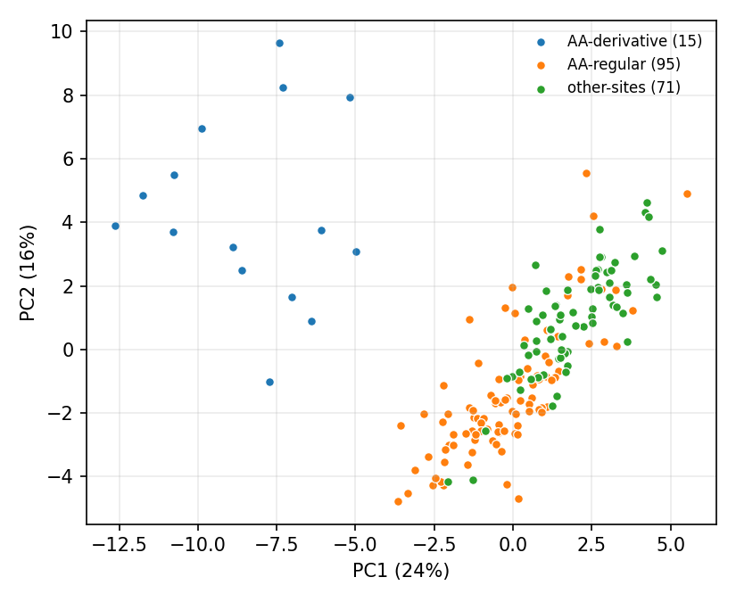

# Parallax Core 42

**42 named, deterministic measurements of an H&E patch. Built to find the batch you didn't know you had.**

Core42 turns an RGB histology patch into 42 numbers, each a named formula: soft-gradient fields, haematoxylin-channel blob statistics, the geometry of luminance and colour-opponent edges, multiscale void and orientation structure, and radial organisation. No training, no reference cohort at run time, no randomness: the same pixels give the same numbers.

That makes it sensitive to the tissue and to everything that happened to it: the site, the scanner and file conversion, the stain, the sampled extent. In a cohort, that sensitivity is useful. If your slides split by how they were made, Core42 tends to show it, and it shows **which named measurements** do the splitting, so you can go and look.

- **Provenance and cohort QC.** Do your slides group by site, scanner, production route or preparation? Which axes separate them? [Worked example on TCGA-COAD](#worked-example-tcga-production-routes).
- **An interpretable block next to colour.** In a pre-registered Camelyon17 test, adding the 42 axes to colour summaries raised AUROC by +0.044 to +0.046, including with whole hospitals held out (+0.046).
- **Section fingerprints.** Two non-overlapping tile sets from the same TCGA slide find each other 89% of the time (top-1 nearest-neighbour retrieval over quantile summaries, 174 slides).

**It is not a better classifier than ordinary texture features.** In both pre-registered tests a plain grayscale-texture family scored higher than the 42 axes on their own, and on held-out hospitals higher than colour plus the 42 axes. It is not a per-slide artefact detector either: for blur, folds and pen marks use [HistoQC](https://github.com/choosehappy/HistoQC). Read [How it compares](docs/HOW_IT_COMPARES.md) before citing a number.

## Install

```bash
pip install "parallax-core42 @ git+https://github.com/parallaxmetrology/parallax-core42"
```

Python 3.11+, numpy, scipy, scikit-image, Pillow. A validated wheel is in `dist/`.

## Use

```bash
parallax-core42 patch.png --output measurements.csv
parallax-core42 patches/ --recursive --output measurements.jsonl

# optional, explicit: corrected fixed-Macenko normalisation with the bundled target
parallax-core42 patches/ --recursive \
  --macenko-target references/tcga_fixed_macenko_target.json --output normalised.csv
```

```python
from parallax_core42 import AXES, measure_path

row = measure_path("patch.png")
assert row["status"] == "ok"
values = [row[axis] for axis in AXES]   # 42 floats in frozen order
```

Each output row has 14 provenance and status fields followed by the 42 axes. Long edges above 512 px are reduced to 512; smaller patches are not enlarged. The constants are frozen: a modified configuration raises an error, and any change would be a new, separately named schema.

## Worked example: TCGA production routes

181 TCGA-COAD patients, 8 tumour tiles each, from three production routes: regular site-AA scans, 15 small derivative files from the same site, and Aperio scans from five other sites. Image only, plan hashed before measuring.



- **No labels:** the derivative slides sit apart from everyone else on the first two principal components.
- **No fitting, per axis:** 19 of 42 axes separate derivative from regular AA patients at AUC ≥ 0.8 or ≤ 0.2, led by the pixel-scale axes (`gap_ds`, `k_ds` 1.00). Those slides' tiles were enlarged about 2.5×, and the axes defined in pixel distances are the ones that notice.
- **Named fitted readout:** shrinkage LDA, leave one patient out, separates all three routes with balanced accuracy 0.977 (0.960 after normalisation).

Groups already known to differ, so a demonstration rather than a discovery. The point is the **named axes** that carry each split. Details, caveats and a script to run the same report on your own cohort: [examples/tcga_route_fingerprint](examples/tcga_route_fingerprint/README.md), [examples/fingerprint_cohort.py](examples/fingerprint_cohort.py).

## What to know before using it

- **Frame- and scale-dependent by design.** Several axes change with rotation or crop, and all act in pixels, not microns. Control patch size and resolution, or study them. Core42 never infers µm/px.
- **Some names overstate.** `blob_density` is a detection rate, not a nucleus count; `omega` is mask-centroid disagreement, not the reference-based "Omega" of earlier Parallax documents.
- **Normalisation is optional and changes several axes.** The bundled normaliser is the corrected one; the degenerate version from early Parallax work is excluded. Normalising does not remove site structure.
- **A grouping is a lead, not a cause.** Core42 records handling as well as biology.

Full list: [docs/KNOWN_ISSUES.md](docs/KNOWN_ISSUES.md). Every axis, its unit and its caution: [docs/AXIS_DICTIONARY.md](docs/AXIS_DICTIONARY.md) and [.csv](docs/AXIS_DICTIONARY.csv). What it does not claim: [docs/SCOPE_AND_BOUNDARIES.md](docs/SCOPE_AND_BOUNDARIES.md).

## Validate

```bash
pip install -e ".[dev]"
PYTHONPATH=src python validate_release.py --check-only    # 71 checks
shasum -a 256 -c MANIFEST_SHA256.txt
pytest -q
```

On its reference platform (macOS arm64, locked versions in `requirements-lock.txt`) the release reproduces the archived v4.1 research kernel on all 42 axes with maximum absolute difference 0.0, on a bundled synthetic fixture and on a real H&E tile (not bundled). Other platforms differ at the floating-point level (up to about 1.4e-8 relative on Linux x86_64); CI checks both, and `scripts/platform_check.py` reports the differences on your machine. The fixture is synthetic and redistributable; it exercises the numerical path and says nothing about biology. Details: [docs/VALIDATION.md](docs/VALIDATION.md), [docs/PROVENANCE.md](docs/PROVENANCE.md).

## Contribute

- Run it on **your** cohort and report what grouped and what didn't, using the "Results on your cohort" issue template. A null is as useful as a hit.
- Bring a cohort with known batches (restains, rescans, scanner changes): that is the test this instrument most needs.
- Spot an axis whose description doesn't match how a pathologist or imaging scientist would read it.

## Part of Parallax Metrology

One principle across domains: structure has geometry, and geometry is measurable without knowing what it means. Siblings: [he-checks](https://github.com/parallaxmetrology/he-checks) (two silent failures in H&E pipelines), [structural-topology-kernel](https://github.com/parallaxmetrology/structural-topology-kernel) (materials), [visual-thinking-lens](https://github.com/parallaxmetrology/visual-thinking-lens) (images). The wider pathology programme, including its retracted and bounded claims: [parallaxmetrology.com](https://www.parallaxmetrology.com/parallax_pathology_pm.html) and the [claim ledger](https://www.parallaxmetrology.com/Parallax_Pathology_Claim_Ledger.html).

## Credits, licence and citation

Russell Parrish, Parallax Metrology. The v1.0 release (reconstruction, freezing, validation) was engineered with Codex (OpenAI); public packaging, the worked example and documentation with Claude (Anthropic).

Code: MIT ([LICENSE](LICENSE)). Documentation: CC BY 4.0 ([LICENSE-CONTENT](LICENSE-CONTENT)). Research software, not a medical device ([NOTICE.md](NOTICE.md)). Cite via [CITATION.cff](CITATION.cff).
