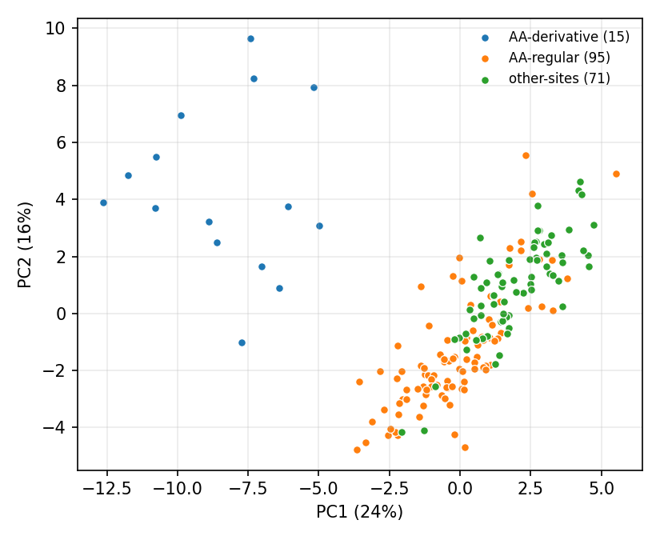

# Worked example: TCGA-COAD production routes

**Question.** With no labels in the measurement, does Core42 show how TCGA colorectal diagnostic slides were produced? Image only: no outcome, clinical or label data were read. The plan ([PLAN.md](PLAN.md)) was written and hashed before any tile was measured.

## Data

181 TCGA-COAD patients, 8 tumour tiles each (1,446 tiles), from the Kather et al. 2020 TCGA tile archive (Zenodo 3784345, 512-px tiles). Patients fall into three production routes, read from public slide headers:

| route | patients | what it is |
|---|---|---|
| `AA-regular` | 95 | site AA (Indivumed), MIRAX scans converted to SVS, about 0.23 µm/px |
| `AA-derivative` | 15 | site AA, small derivative files with no scale tag; their stated IDC spacing is wrong ([he-checks](https://github.com/parallaxmetrology/he-checks)). In this archive their tiles are 200-px crops enlarged to 512 px |
| `other-sites` | 71 | sites A6, AZ, AY, 5M, 4T, Aperio-native scans, about 0.25 µm/px |

`AA-regular` against `AA-derivative` holds the tissue source site fixed and changes only the route. `other-sites` differs from `AA-regular` in both site and scanner, which this example cannot separate. Two further derivative patients (TCGA-AA-3488, -3713) have no tiles in the historical patient table and are not included.

## Result



**Without labels**, the 15 derivative patients sit apart from everyone else on the first two principal components of the patient medians (projection fitted on all patients without labels). The two regular routes overlap there.

**Per axis, without fitting** (patient-level AUC, raw RGB):
- Derivative vs regular AA: 19 of 42 axes have AUC ≥ 0.8 or ≤ 0.2. The strongest are the distance-transform and void-size axes (AUC for derivative over regular: `gap_ds` and `k_ds` 1.00, `b_ds` 0.995, `g2_cut` and `g2_V` 0.99). Those are the pixel-scale-sensitive axes, which is what a 2.5× enlargement should move.
- Other sites vs regular AA: 11 of 42; strongest `gamma` 0.01, `k_theta` 0.02, `b_ds` 0.08, `blob_density` 0.10.

**With a named fitted readout** (shrinkage LDA, leave-one-patient-out, equal priors): balanced accuracy 0.977 across the three routes (chance 0.333). All 15 derivative patients are identified; 4 of 95 regular AA and 2 of 71 other-site patients are misassigned.

**After the bundled fixed-Macenko normalisation**: balanced accuracy 0.960; derivative vs regular AA 17/42 strong axes; other sites vs regular AA 8/42. Normalisation weakens the site and scanner split a little and leaves the scale split almost untouched.

## How to read it

- This is a demonstration on groups already known to differ, not a test of a new hypothesis. It shows what the instrument exposes and **which named axes** carry each split.
- The derivative split is a scale artefact made visible: the axes that separate them are the ones defined in pixel distances. In our own work, following up this group of slides turned up 25 TCGA slides with wrong stated pixel spacing.
- The other-sites split is site and scanner together. Telling them apart needs a design that varies one at a time (restains, rescans).
- Tumour tiles only; 8 tiles per patient; patient medians. Other sampling choices may give different strengths.

## Reproduce

From the shipped measurements (exact):

```bash
pip install -e ".[examples]"
python examples/fingerprint_cohort.py examples/tcga_route_fingerprint/tile_measurements_raw.csv \
  --group route --unit patient --out report_raw
```

From the images: download the tile zips for the patients in [routes.csv](routes.csv) from Zenodo 3784345, then

```bash
python examples/tcga_route_fingerprint/measure_tcga_tiles.py --tiles /path/to/zips --routes examples/tcga_route_fingerprint/routes.csv
```

The tile selection is deterministic (seed 20261106); a spot check of three patients reproduced the same tiles and the same values to within 2e-15.

Files: `tile_measurements_{raw,macenko}.csv` (one row per tile: route, patient, tile name, status, 42 axes), `routes.csv`, `report_{raw,macenko}/` (AUCs, patient medians, PCA, summary).
